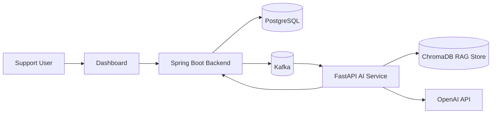
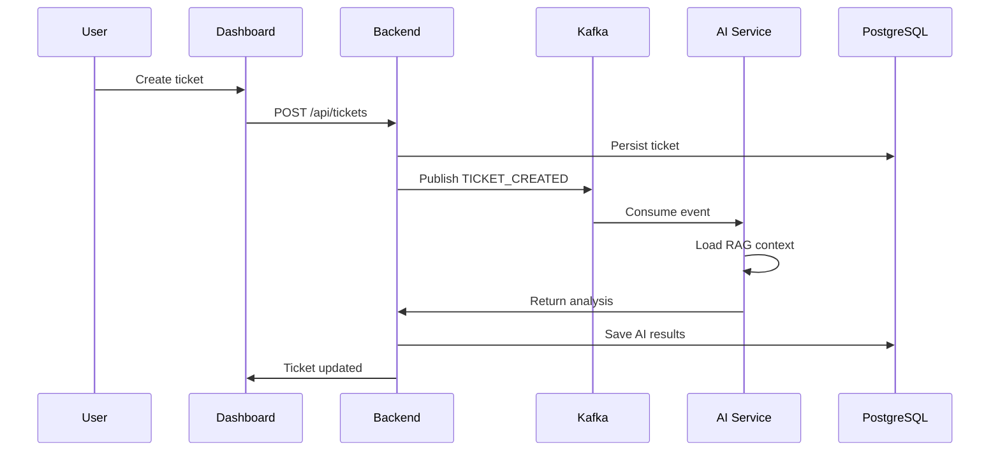

# Customer Support Intelligence Platform

Customer Support Intelligence Platform is a full-stack support workflow app with ticket management, agent assignment, asynchronous AI analysis, and a dashboard for tracking support activity.

The system is split into three services:

- `support`: Spring Boot backend for customers, agents, tickets, Kafka events, and persistence
- `ai-service`: FastAPI service that analyzes tickets with RAG over a local knowledge base
- `dashboard`: Next.js frontend for interacting with the platform

## Features

- Create and manage customers, agents, and tickets
- Assign tickets to agents and track assignment history
- Record ticket activity and AI processing status
- Publish ticket-created events through Kafka
- Run AI analysis asynchronously through the AI service
- Use RAG with Markdown knowledge-base documents
- Retry failed AI processing
- Run the full stack with Docker Compose

## Tech Stack

| Part | Stack |
|---|---|
| Backend | Java 21, Spring Boot 3.5.6, Spring Data JPA, Spring Kafka |
| Frontend | Next.js 16, React 19, TypeScript |
| AI Service | Python, FastAPI, OpenAI, ChromaDB |
| Database | PostgreSQL 16 |
| Messaging | Apache Kafka 4 |
| Tooling | Docker, Docker Compose |

## Repository Layout

```text
customer-support-intelligence-platform/
|-- support/
|-- ai-service/
|-- dashboard/
|-- docker-compose.yaml
`-- README.md
```

## Architecture


## Ticket Flow



## Services

The root `docker-compose.yaml` starts these containers:

- PostgreSQL on `5432`
- Kafka on `9092`
- AI service on `8000`
- Backend on `8080`
- Dashboard on `3000`

## Local Setup

### Prerequisites

- Docker Desktop
- Git
- OpenAI API key for the AI service

### Environment

Set `OPENAI_API_KEY` for the AI service before starting the stack. Do not commit secrets or `.env` files.

### Build and Run

From the project root:

```bash
docker compose up -d --build
```

To check containers:

```bash
docker compose ps
```

If you want to build the Spring Boot backend separately:

```bash
cd support
.\mvnw.cmd clean package -DskipTests
```

## Access

- Dashboard: `http://localhost:3000`
- Backend: `http://localhost:8080`
- Backend health: `http://localhost:8080/actuator/health`
- AI service: `http://localhost:8000`
- AI service health: `http://localhost:8000/health`

## API Summary

Customers

- `POST /api/customers`
- `GET /api/customers`
- `GET /api/customers/{id}`

Agents

- `POST /api/agents`
- `GET /api/agents`

Tickets

- `POST /api/tickets`
- `GET /api/tickets`
- `GET /api/tickets/{id}`
- `PATCH /api/tickets/{id}`
- `PATCH /api/tickets/{id}/agent/{agentId}`
- `GET /api/tickets/{id}/assignment-history`
- `GET /api/tickets/{id}/activity`
- `POST /api/tickets/{id}/retry-ai`

## AI Service

The AI service loads knowledge documents from `ai-service/knowledge_base/` and uses them to build RAG context for ticket analysis. The current knowledge base includes:

- `account-access.md`
- `payment-troubleshooting.md`
- `refund-policy.md`

## Notes

- The backend uses PostgreSQL and Kafka through environment-based configuration.
- The AI service exposes a health endpoint and a ticket analysis endpoint.
- The project includes automated tests in the backend and AI service directories.
